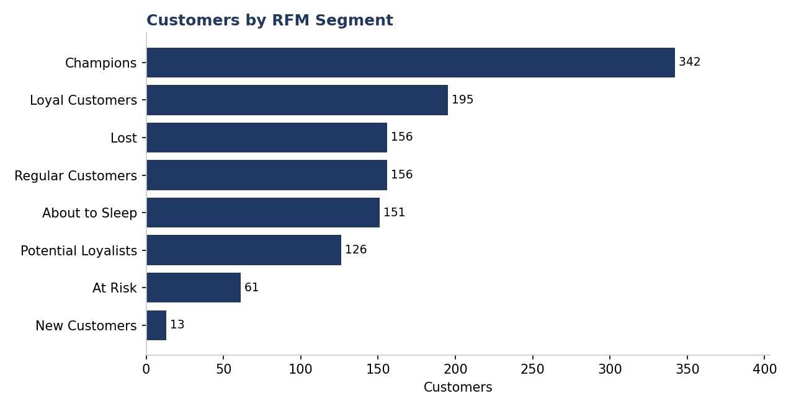
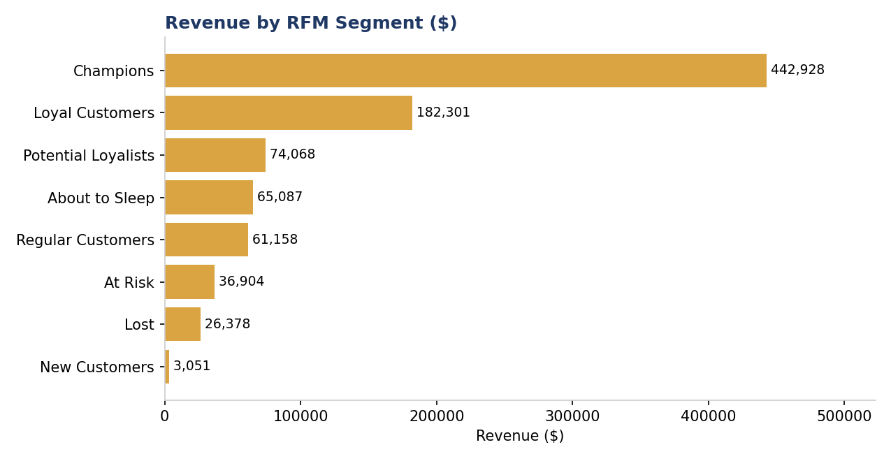
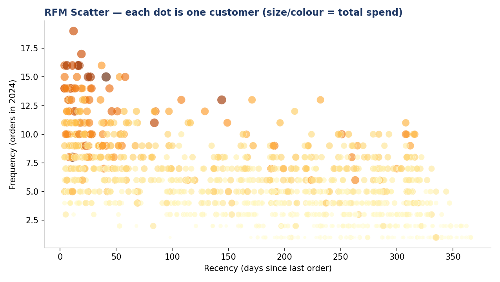

# Customer Segmentation — RFM Analysis (Python)

**Who are your best customers — and which ones are about to disappear?**

This project segments **1,200 e-commerce customers** (6,672 orders, calendar year 2024) with the classic **RFM framework** — Recency, Frequency, Monetary — and turns the segments into concrete marketing actions.

## Key findings

- **342 Champions (28.5% of customers) produced $442,928 — 49.7% of all revenue.** Fewer than 3 in 10 customers pay for half the business. Protecting this group matters more than acquiring new customers.
- **The top 3 segments hold 78.4% of revenue** (Champions + Loyal Customers + Potential Loyalists) — retention spend should be concentrated there, not spread evenly.
- **61 "At Risk" customers are worth $36,904 in past revenue** and haven't ordered recently despite buying frequently before — the highest-ROI win-back target in the base.
- **156 customers (13%) are effectively Lost** — still receiving generic marketing by default in most businesses. They should get one final win-back offer, then be removed from paid campaigns.
- **"About to Sleep" (151 customers, $65,087)** is the quiet danger zone: one personalized nudge now is far cheaper than a win-back campaign later.

## Method

1. Load 6,672 transactions (`data/transactions.csv`), snapshot date 1 Jan 2025.
2. Compute per customer: **Recency** (days since last order), **Frequency** (orders in 2024), **Monetary** (total spend).
3. Score each dimension 1–5 by percentile rank; assign one of 8 segments by rule set (see `rfm_analysis.py`).
4. Aggregate customers, revenue and average value per segment → charts + actions.

## Recommended actions (what a business should do with this)

| Segment | Action |
|---|---|
| Champions | Early access, referral asks, zero discount needed |
| Loyal Customers | Loyalty programme + bundle offers |
| Potential Loyalists | Second/third-purchase nudges, free-shipping threshold |
| At Risk | Personal win-back offer within 30 days |
| About to Sleep | Re-engagement email series before they go cold |
| Lost | One last-chance offer, then suppress from paid ads |

## Tools & skills

Python · pandas · percentile scoring · customer segmentation · data visualization (matplotlib) · marketing analytics

## Files

| File | What it is |
|---|---|
| `data/transactions.csv` | 6,672 synthetic e-commerce orders, 2024 |
| `rfm_analysis.py` | Full pipeline: load → RFM → segments → summary |
| `rfm_segments.csv` | Every customer with R/F/M scores + segment |
| `charts/` | Customers by segment, revenue by segment, RFM scatter |

> **Note:** the dataset is synthetic (generated for portfolio purposes, with a realistic loyalty/churn structure). All figures above are computed from it by the script — no hand-written numbers.

*Author: [Faheem Rind](https://github.com/orhandataanalyst) — Data Analyst · Excel · SQL · Python · Power BI*
